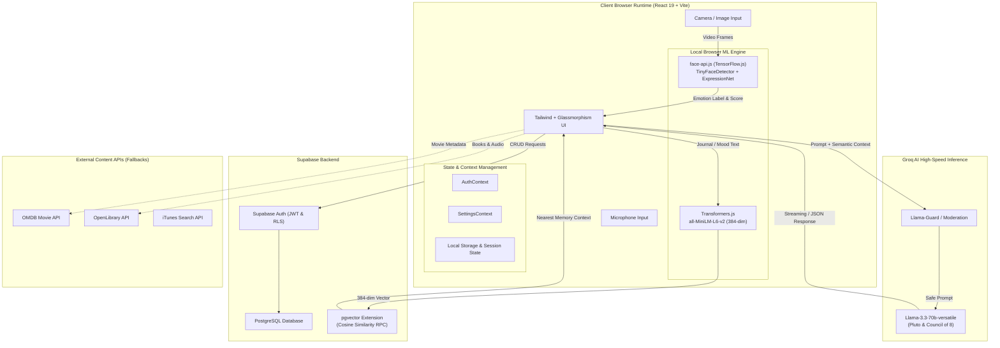

<div align="center">

# 🌱 Evolve — Personal Growth & Mindfulness Companion

**An intelligent, privacy-first personal growth platform combining real-time client-side emotion recognition, local semantic vector memory, an adaptive mindful companion, and psychological archetype counseling.**

[](https://reactjs.org/)
[](https://www.typescriptlang.org/)
[](https://vitejs.dev/)
[](https://groq.com/)
[](https://supabase.com/)
[-yellow?logo=huggingface&logoColor=black)](https://huggingface.co/docs/transformers.js)
[](https://justadudewhohacks.github.io/face-api.js/)
[](LICENSE)

[Features](#-key-features) • [Architecture](#-system-architecture) • [Tech Stack](#%EF%B8%8F-tech-stack) • [Quick Start](#-quick-start) • [Database Setup](#-database-setup--migrations) • [Environment Variables](#-environment-variables) • [Privacy & Security](#-privacy--security-model) • [Troubleshooting](#-troubleshooting)

</div>

---

## 📖 Table of Contents

- [Overview](#-overview)
- [Key Features](#-key-features)
- [System Architecture](#-system-architecture)
- [Tech Stack](#%EF%B8%8F-tech-stack)
- [Directory Structure](#-directory-structure)
- [Prerequisites](#-prerequisites)
- [Quick Start](#-quick-start)
- [Environment Variables](#-environment-variables)
- [Database Setup & Migrations](#-database-setup--migrations)
- [Available Scripts](#-available-scripts)
- [Privacy & Security Model](#-privacy--security-model)
- [Troubleshooting](#-troubleshooting)
- [Contributing](#-contributing)
- [License](#-license)

---

## 🌟 Overview

**Evolve** is a modern, full-spectrum personal growth and emotional wellness platform. Unlike traditional mood trackers that rely exclusively on manual subjective logs, Evolve blends **in-browser computer vision**, **client-side semantic embedding generation**, and **cloud-accelerated LLM reasoning** to deliver hyper-personalized self-reflection without compromising user privacy.

Every interaction—from real-time facial expression analysis to mood radar generation, gamified self-improvement challenges, and deep psychological dialogue with the **Council of Eight**—is designed with a calming, liquid-glass aesthetic that adapts fluidly across daytime and nighttime themes.

---

## ✨ Key Features

### ☁️ Pluto — Your Mindful Cloud Companion
- **Adaptive Persona**: Pluto is an empathetic, floating AI cloud entity that lives on your dashboard.
- **Dynamic Interaction Engine**: Hovering over Pluto triggers real-time stream-of-consciousness reflections (e.g., *"Breathe in, breathe out..."*, *"Floating through thoughts..."*).
- **Context-Injected RAG**: Automatically queries local semantic memory vectors to recall past journals and moods, giving Pluto deeply coherent conversational continuity.

### 🏛️ The Council of Eight — Psychological Archetype Advisory
Engage in multi-perspective cognitive reflection with 8 specialized AI archetypes:
1. **The Shadow** *(Jungian Integration)*: Exposes secondary gains, hidden payoff mechanisms, and defense mechanisms.
2. **The Stoic Architect** *(REBT & Dichotomy of Control)*: Strips emotional hyperbole into actionable vs. non-controllable factors.
3. **The Absurdist** *(Cognitive Defusion & Logotherapy)*: Deconstructs catastrophic anxiety through cosmic perspective.
4. **The Existentialist** *(Radical Freedom & Responsibility)*: Focuses on authentic choices and personal accountability.
5. **The Taoist Sage** *(Wu Wei & Flow)*: Encourages effortless action, acceptance, and letting go of rigid expectations.
6. **The Compassionate Witness** *(Internal Compassion & Self-Soothing)*: Provides unconditional emotional validation.
7. **The Pragmatic Strategist** *(System Dynamics & Kaizen)*: Breaks overwhelming challenges into micro-habits.
8. **The IFS Guide** *(Internal Family Systems)*: Identifies and unburdens protective parts and exiles.

### 👁️ 100% Private Client-Side Emotion Detection
- **Real-Time Camera Scanning**: Evaluates 7 core emotional expressions (*Happy, Sad, Angry, Fear, Disgust, Surprise, Neutral*) via facial landmark evaluation.
- **Client-Side Execution**: Powered by `face-api.js` and TensorFlow.js running inside WebAssembly. **Zero video feeds or face pictures leave your browser.**
- **Image Upload Analysis**: Upload personal photos to extract emotional sentiment indicators offline.

### 🧠 Private In-Browser Semantic Memory (pgvector RAG)
- **Zero-Cost Browser Embeddings**: Uses `@huggingface/transformers` to run the `all-MiniLM-L6-v2` model in-browser, generating 384-dimensional vector embeddings without expensive third-party embedding APIs.
- **Supabase pgvector Storage**: Stores vectorized memories in a specialized `memory_nodes` relation with IVFFlat / HNSW cosine distance indexing.
- **Smart Backfill Engine**: Automatically generates vector embeddings for historical mood and journal logs with built-in deduplication.

### 🛡️ Llama-Guard AI Safety Layer
- Real-time safety moderation intercepting conversational input before processing.
- Automatically recognizes crisis language and triggers supportive crisis-intervention hotlines and resources.

### 📝 Smart Emotional Journaling
- **Mood-Tagged Reflection**: Automatically associates written entries with contemporaneous emotion metrics.
- **Audio Journal Recording**: Voice recording integration with real-time waveform visualization.
- **Persistent Bookmarks**: One-click favorite preservation accessible via a sliding bookmark drawer.

### 🗺️ Discovery Path & Gamification
- Science-backed mental wellness tasks (e.g., *"3 Good Things"*, *"Box Breathing"*, *"5-4-3-2-1 Grounding"*).
- Habit streak counters and milestone tracking to foster lasting behavioral change.

### 📊 Behavioral Analytics & Music DNA
- **Interactive Mood Trend Chart**: Numerical grade indicators (e.g., `8.5/10`) aligned with emotional color shifts.
- **Emotional Spectrum Radar**: Multi-axis radar visualization highlighting emotional balance over rolling periods.
- **Music DNA**: Discovers aesthetic and musical affinities tailored to emotional recovery.

### 🎨 Chameleon Dual-Theme Interface
- **Dark Theme**: Deep space, slate, and calming night-sky glassmorphism.
- **Light Theme**: Warm cream, sage, and airy canvas with custom particle animations (`WellnessBackgroundLight.tsx`).

---

## 🏗️ System Architecture



---

## 🛠️ Tech Stack

| Domain | Technologies |
|---|---|
| **Frontend Framework** | [React 19](https://react.dev/), [TypeScript 5.8](https://www.typescriptlang.org/), [Vite 6](https://vitejs.dev/) |
| **Styling & Effects** | [Tailwind CSS](https://tailwindcss.com/), [Framer Motion](https://www.framer.com/motion/), [Lucide React](https://lucide.dev/) |
| **In-Browser Vision ML** | [face-api.js](https://justadudewhohacks.github.io/face-api.js/) via `@tensorflow/tfjs` |
| **In-Browser Embedding ML** | [@huggingface/transformers](https://huggingface.co/docs/transformers.js) (`all-MiniLM-L6-v2`) |
| **Cloud LLM Inference** | [Groq Cloud](https://groq.com/) (`llama-3.3-70b-versatile`) |
| **AI Safety Layer** | Llama-Guard / Moderation pipeline |
| **Backend & Storage** | [Supabase](https://supabase.com/) (PostgreSQL 15+, Supabase Auth, Row-Level Security) |
| **Vector Database** | [pgvector](https://github.com/pgvector/pgvector) PostgreSQL extension |
| **Data Visualization** | Custom SVG Radar Maps, Canvas Blob Particles, Dynamic Trend Visualizers |

---

## 📂 Directory Structure

```
evolve-companion-application/
├── components/                  # Reusable React UI components
│   ├── ActivityCard.tsx         # Gamified wellness activity card
│   ├── AddMaterialCard.tsx      # Custom media interest submission card
│   ├── AIInsights.tsx           # Deep pattern recognition insight cards
│   ├── AnimatedBackground.tsx   # Ambient background container
│   ├── AudioJournalCard.tsx     # Voice recording and playback component
│   ├── CameraCapture.tsx        # In-browser webcam emotion capture
│   ├── ChatAssistantButton.tsx  # Floating Pluto launcher trigger
│   ├── DiscoveryPathCard.tsx    # Daily self-improvement quest card
│   ├── EmotionScanCard.tsx      # Face detection viewfinder & confidence meters
│   ├── Header.tsx               # Top navigational bar & user session indicator
│   ├── InterestRadarMap.tsx     # Multi-axis SVG radar map (Interests & Music DNA)
│   ├── JournalEditor.tsx        # Rich journal input with emotion tagging
│   ├── MoodLog.tsx              # Historical mood entries feed
│   ├── MoodTrendChart.tsx       # Numerical trend chart with emotional scorecards
│   ├── QuoteCard.tsx            # Dynamic inspirational philosophy quote card
│   ├── Sidebar.tsx              # Main navigation drawer
│   ├── SuggestionsPanel.tsx     # Curated content suggestions (Books/Movies/Music)
│   ├── WeeklySummaryCard.tsx    # Groq-generated weekly emotional review
│   ├── WellnessBackground.tsx   # Dark mode animated canvas background
│   └── WellnessBackgroundLight.tsx # Light mode pastel animated canvas background
├── contexts/                    # Global React Context providers
│   ├── AuthContext.tsx          # Supabase authentication state & profile
│   └── SettingsContext.tsx      # Appearance, font sizing, theme preferences
├── data/                        # Static seeds and activity definitions
│   └── discoveryActivities.ts   # Curated pool of psychological exercises
├── docs/                        # Architecture and technical documentation
│   └── CODE_WIKI.md             # In-depth internal architectural guide
├── lib/                         # Client initialization singletons
│   └── supabase.ts              # Supabase client instantiation & TypeScript schema
├── pages/                       # Application view routes
│   ├── ChatAssistantPage.tsx    # Full-screen Pluto conversational interface
│   ├── CouncilOfEightPage.jsx   # Multi-archetype psychological advisory council
│   ├── InsightsPage.tsx         # Long-term analytics and correlation charts
│   ├── InterestsPage.tsx        # Taste profile & Music DNA exploration
│   └── JournalPage.tsx          # Journal chronicle and bookmark drawer
├── public/                      # Static assets & public distribution
│   └── models/face-api/         # Pre-trained Face-API neural network model weights
├── services/                    # Cloud & backend API services
│   ├── councilService.ts        # Council of 8 archetype prompts and handlers
│   ├── database.ts              # Supabase CRUD operations & memory sync
│   ├── embeddingService.ts      # Transformers.js client-side vector embedding generator
│   ├── groq.ts                  # Groq API client with context injection & retry logic
│   ├── moderationService.ts     # Llama-Guard safety moderation interceptor
│   └── recommendationApi.ts     # OMDB, iTunes, OpenLibrary search clients
├── supabase/                    # PostgreSQL migrations & database scripts
│   ├── schema.sql               # Base tables, indexes, and Row Level Security
│   ├── pgvector_setup.sql       # Vector extension, memory_nodes table & match RPC
│   ├── update_content_type.sql  # Schema migration: content_type constraints
│   ├── update_genres_column.sql # Schema migration: array column for music genres
│   └── update_user_settings.sql # Schema migration: user appearance preferences
├── types/                       # Shared TypeScript type definitions
│   ├── discovery.ts             # Discovery tasks and milestone types
│   ├── interests.ts             # Media and music interest schemas
│   ├── journal.ts               # Journal entry and bookmark interfaces
│   ├── moods.ts                 # Emotion classification categories & scores
│   └── settings.ts              # Theme, font, and personalization options
├── utils/                       # Algorithmic and analytical helpers
│   ├── backfillMemories.ts      # Retroactive batch embedding processor
│   ├── discoveryLogic.ts        # Mood-to-task assignment heuristics
│   ├── emotionAnalyzer.ts       # Face-API landmark and expression evaluation
│   ├── suggestionEngine.ts      # Multi-tier recommendation fallback engine
│   └── textEmotionAnalyzer.ts   # Client-side AFINN lexical sentiment analysis
├── .env.example                 # Environment variables template
├── .gitignore                   # Comprehensive Git exclusion rules
├── App.tsx                      # Root component & page router
├── chatbot persona.txt          # Reference prompt engineering notes for archetypes
├── index.html                   # HTML5 document shell & font imports
├── index.css                    # Global CSS variables & glassmorphism utilities
├── index.tsx                    # Application entry mount point
├── package.json                 # Project dependencies & build scripts
├── requirements.txt             # Environment specifications & optional Python tools
├── runBackfill.ts               # Standalone vector backfill CLI utility
├── SUPABASE_SETUP.md            # Detailed Supabase walkthrough guide
├── tsconfig.json                # TypeScript compiler configuration
├── update_log.md                # Detailed release change history
└── vite.config.ts               # Vite bundler configuration & environment mapping
```

---

## 📋 Prerequisites

Ensure you have the following installed before setting up the application:

- **Node.js**: `v18.0.0` or higher (`v20.x LTS` strongly recommended).
- **Package Manager**: `npm` (`v9+`), `pnpm`, or `yarn`.
- **Modern Browser**: Chrome, Edge, Firefox, or Safari with WebGL and WebAssembly support.
- **Supabase Account**: A free project from [supabase.com](https://supabase.com).
- **Groq Cloud Account**: A free API key from [console.groq.com](https://console.groq.com).

---

## 🚀 Quick Start

### 1. Clone the Repository

```bash
git clone https://github.com/Loukhya/evolve_AI_companion_app.git
cd evolve_AI_companion_app
```

### 2. Install Dependencies

```bash
npm install
```

### 3. Configure Environment Variables

Copy the example environment configuration:

```bash
cp .env.example .env
```

Open `.env` in your text editor and provide your keys:

```env
VITE_SUPABASE_URL=https://your-project-ref.supabase.co
VITE_SUPABASE_ANON_KEY=your_supabase_anon_public_key_here
VITE_GROQ_API_KEY=your_groq_api_key_here
VITE_OMDB_API_KEY=your_omdb_api_key_here
```

> [!NOTE]
> See [Environment Variables](#-environment-variables) for guidance on where to acquire each key.

### 4. Setup Database Tables & Vector Extensions

Follow the [Database Setup Guide](#-database-setup--migrations) below to initialize your Supabase schema and vector memory storage.

### 5. Launch the Development Server

```bash
npm run dev
```

Open [http://localhost:3000](http://localhost:3000) in your browser.

---

## 🔐 Environment Variables

| Variable | Required | Description | How to Obtain |
|---|:---:|---|---|
| `VITE_SUPABASE_URL` | **Yes** | Your Supabase project REST API endpoint | [Supabase Dashboard](https://supabase.com) → *Project Settings* → *API* |
| `VITE_SUPABASE_ANON_KEY` | **Yes** | Public anonymous client API key | [Supabase Dashboard](https://supabase.com) → *Project Settings* → *API* |
| `VITE_GROQ_API_KEY` | **Yes** | Fast LLM inference key for Pluto & Council of Eight | [Groq Cloud Console](https://console.groq.com/keys) (Free tier) |
| `VITE_OMDB_API_KEY` | *No* | Real-time movie metadata & poster lookups | [OMDb API Key](https://www.omdbapi.com/apikey.aspx) (Optional fallback provided) |
| `GEMINI_API_KEY` | *No* | Optional legacy fallback | [Google AI Studio](https://aistudio.google.com/) |

> [!CAUTION]
> **Never commit your `.env` file to version control.** The `.gitignore` file is pre-configured to exclude all `.env` files.

---

## 🗄️ Database Setup & Migrations

Evolve requires PostgreSQL with the `pgvector` extension for full semantic memory capabilities. Run the provided SQL scripts in the **Supabase SQL Editor** in the following order:

### Execution Order:

1. **Base Tables & Security**: Run [`supabase/schema.sql`](supabase/schema.sql)
   - Creates `mood_entries` and `journal_entries` tables.
   - Sets up indexed foreign keys linked to `auth.users(id)`.
   - Enables Row Level Security (RLS) guaranteeing private user data partition.

2. **Semantic Vector Graph (pgvector)**: Run [`supabase/pgvector_setup.sql`](supabase/pgvector_setup.sql)
   - Enables the `vector` extension (`CREATE EXTENSION IF NOT EXISTS vector;`).
   - Creates the `memory_nodes` table with a 384-dimensional vector column (`embedding vector(384)`).
   - Creates the `match_memories` PostgreSQL RPC function for fast cosine similarity nearest-neighbor lookup.

3. **Incremental Schema Updates**:
   - [`supabase/update_content_type.sql`](supabase/update_content_type.sql) — Enforces strict check constraints for content categories.
   - [`supabase/update_genres_column.sql`](supabase/update_genres_column.sql) — Adds support for multi-genre array indexing.
   - [`supabase/update_user_settings.sql`](supabase/update_user_settings.sql) — Provisions persistence for user layout and theme preferences.

---

## ⚡ Available Scripts

| Command | Description |
|---|---|
| `npm run dev` | Starts Vite development server at `http://localhost:3000` with HMR |
| `npm run build` | Compiles TypeScript and builds optimized production assets in `dist/` |
| `npm run preview` | Locally serves the production build from `dist/` |
| `npx tsx runBackfill.ts` | CLI script to retroactively compute vector embeddings for existing records |

---

## 🛡️ Privacy & Security Model

Evolve was engineered with a strict **Privacy-By-Design** philosophy:

```
┌────────────────────────────────────────────────────────┐
│                   USER'S LOCAL BROWSER                 │
│                                                        │
│  [Webcam Stream] ──> [TensorFlow.js / Face-API]        │
│                              │                         │
│                    (Raw frames discarded)              │
│                              ▼                         │
│                  [Only Emotion Classification]         │
│                     e.g., "Happy (0.92)"               │
│                              │                         │
│                              ▼                         │
│                  [Local Transformers.js]               │
│               all-MiniLM-L6-v2 In-Browser              │
│                              │                         │
│                     (384-dim Floats)                   │
└──────────────────────────────┼─────────────────────────┘
                               │
                               ▼ HTTPS Encrypted
┌────────────────────────────────────────────────────────┐
│                   SECURE SUPABASE CLOUD                │
│                                                        │
│  - Encrypted at rest (PostgreSQL)                      │
│  - Row-Level Security (RLS) strictly isolates users     │
│  - Vector cosine matching inside user-isolated schema  │
└────────────────────────────────────────────────────────┘
```

1. **Zero Video Transmission**: Camera frames are analyzed frame-by-frame directly in GPU memory using WebGL and discarded immediately. Only the anonymous numerical classifications (e.g. `happy: 0.88`) are ever stored.
2. **Local Vectorization**: Text embeddings are computed within the user's browser runtime using WebAssembly. Your journal text is never sent to third-party embedding APIs.
3. **Strict Row-Level Security (RLS)**: Every query sent to Supabase is authenticated with a JWT token validated against `auth.uid() = user_id`. No user can ever query or read another user's mood or journal logs.
4. **Safety Circuit Breaker**: Messages passing to Pluto and the Council of 8 are monitored by a local moderation guard to detect acute distress and immediately display verified crisis intervention hotlines.

---

## 🔧 Troubleshooting

### 1. `API Key missing or invalid. Check .env file.`
- **Cause**: Vite was started without valid environment variables in `.env`.
- **Fix**: Verify your `.env` file exists in the project root and includes `VITE_GROQ_API_KEY` and `VITE_SUPABASE_URL`. Restart Vite (`npm run dev`) after editing `.env`.

### 2. Camera or Face Detection Not Initializing
- **Cause**: Browser camera permissions were denied or model weights failed to load.
- **Fix**:
  1. Ensure camera access is allowed in your browser address bar.
  2. Verify that `public/models/face-api/` contains all 4 model files: `face_expression_model-shard1`, `face_expression_model-weights_manifest.json`, `tiny_face_detector_model-shard1`, and `tiny_face_detector_model-weights_manifest.json`.
  3. Ensure your browser supports WebGL.

### 3. Supabase RLS Policy Violations (`403 Forbidden`)
- **Cause**: Queries are executing without an authenticated user session.
- **Fix**: Sign up or log in through the application modal. Ensure that the SQL migration in `supabase/schema.sql` was executed completely.

### 4. Groq Rate Limit (`429 Too Many Requests`)
- **Cause**: Rapid consecutive requests exceeding your Groq tier limits.
- **Fix**: The application includes built-in retry and fallback logic with exponential backoff (`services/groq.ts`). If the Groq API is temporarily unreachable, Evolve switches automatically to offline curated recommendations.

### 5. Large Bundle Size Warning During Build
- **Cause**: Vite displays a warning regarding `@tensorflow/tfjs` and `@huggingface/transformers` WebAssembly binaries (`ort-wasm-simd-threaded.jsep.wasm`).
- **Fix**: This is expected for client-side ML applications. The WebAssembly modules are pre-compiled and run asynchronously in dedicated browser workers.

---

## 🤝 Contributing

Contributions are welcomed and appreciated!

1. Fork the repository
2. Create your feature branch (`git checkout -b feature/mindful-enhancement`)
3. Commit your changes (`git commit -m "feat: add mindful breathing exercise"`)
4. Push to the branch (`git push origin feature/mindful-enhancement`)
5. Open a Pull Request

---

## 📄 License

Distributed under the **MIT License**. See [`LICENSE`](LICENSE) for full details.

---

<div align="center">
Built with ❤️ for mindfulness, personal growth, and emotional well-being.
</div>
